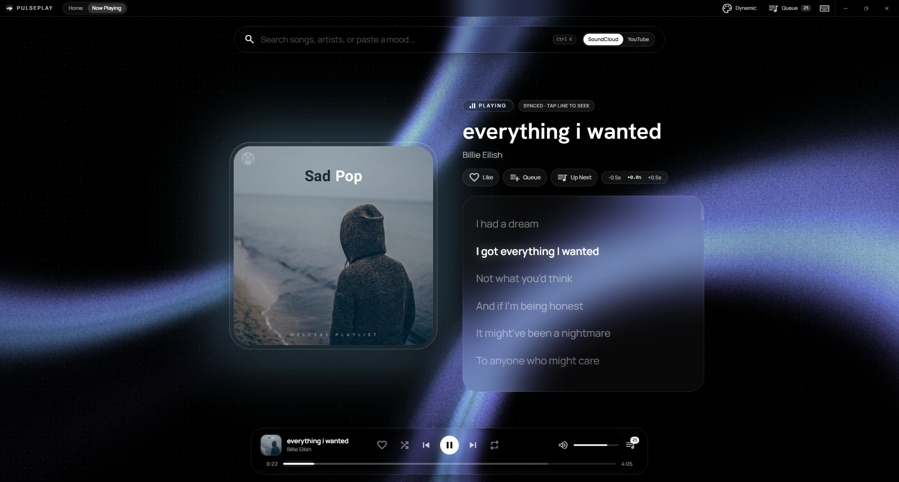

<div align="center">
  
  
  # PulsePlay
  
  **A modern, liquid-glass desktop music player built with Tauri, React, Three.js, and Rust.**
</div>

## ✨ Features

- **Liquid Glass UI & Dynamic Ambient Themes:** Interactive WebGL shader & dot-field background (`Three.js` + `Canvas`) that extracts colors directly from the active album artwork or switches between curated presets (*Obsidian*, *Aurora*, *Sunset*, *Ocean*, *Emerald*).
- **Home Dashboard & Discovery:** Quick vibe chips, recently played history, Liked Songs collection, and custom playlists persisted locally.
- **Full Queue & Autoplay Radio:** Reorder, remove, save queues as playlists, shuffle, 3-state repeat (`Off` / `All` / `One`), and optional Autoplay Radio when your queue finishes.
- **Interactive Synced Lyrics:** Powered by LRCLIB with click-to-seek on synced lines, RTL/Unicode support (`dir="auto"`), manual scroll pause, and `-0.5s / +0.5s` sync offset adjustment.
- **Smooth Streaming Proxy:** Rust-backed HTTP streaming proxy with connection pooling, `Range` / `HEAD` / `OPTIONS` support, and incremental chunked streaming alongside browser/YouTube/iTunes fallbacks.
- **Full Player Controls & Media Keys:** Drag-to-scrub progress bar with hover timestamps & buffer indicator, volume slider with mouse-wheel & mute support, and OS Media Session integration.

## ⌨️ Keyboard Shortcuts

| Key | Action |
| :--- | :--- |
| `Space` | Play / Pause |
| `Ctrl + K` or `/` | Focus Search |
| `←` / `→` | Seek `-5s` / `+5s` |
| `↑` / `↓` | Volume Up / Down |
| `M` | Mute / Unmute |
| `N` / `P` | Next / Previous Track |
| `S` | Toggle Shuffle |
| `R` | Cycle Repeat (`Off` / `All` / `One`) |
| `L` | Like / Unlike Current Track |
| `Q` | Toggle Queue & Library Drawer |
| `H` | Toggle Home / Now Playing |
| `?` | Open Keyboard Shortcuts Modal |
| `Esc` | Close Modals & Dropdowns |

## 📸 Demo



## ⚠️ Important Note Regarding Network Issues

> [!WARNING]
> PulsePlay relies on YouTube and public streaming nodes to fetch and stream songs. If you live in a region where YouTube is blocked or restricted, or if you experience issues such as tracks not loading or searches failing, **please try using a VPN**.

## 🚀 Getting Started

### Prerequisites

- [Node.js](https://nodejs.org/) (v18 or higher)
- [Rust & Cargo](https://rustup.rs/) (required for Tauri)

### Installation

1. **Clone the repository:**
   ```bash
   git clone https://github.com/DanialZaree/pulsePlay.git
   cd pulsePlay
   ```

2. **Install dependencies:**
   ```bash
   npm install
   ```

3. **Run in development mode:**
   ```bash
   npm run tauri dev
   ```
   Or preview the frontend only in a browser:
   ```bash
   npm run dev
   ```

4. **Build for production:**
   ```bash
   npm run tauri build
   ```

## 🛠️ Tech Stack

- **Frontend:** React 19, TypeScript, Tailwind CSS v4, `@developer-hub/liquid-glass`
- **Backend / Desktop Platform:** Tauri v2, Rust, `tokio`, `reqwest`, `rusty_ytdl`
- **Media & Visuals:** Three.js, Canvas 2D, `react-youtube`, LRCLIB API, iTunes Search API
